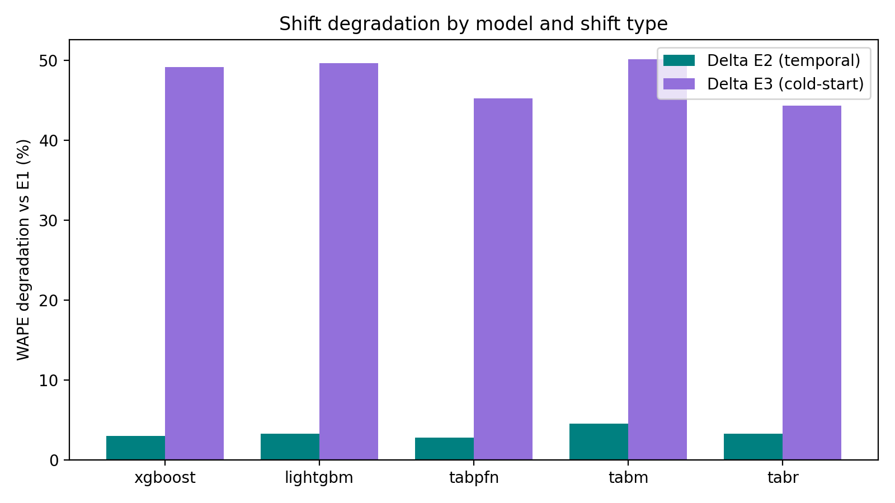

# Results Report

## Master table

| model    |   e1_wape |   e1_std |   e2_wape |   e2_std |   e3_wape |   e3_std |   delta_e2 |   delta_e3 |   sensitivity |
|:---------|----------:|---------:|----------:|---------:|----------:|---------:|-----------:|-----------:|--------------:|
| xgboost  |    0.6311 |   0.0000 |    0.6500 |   0.0000 |    0.9414 |   0.0000 |     0.0299 |     0.4917 |       16.4502 |
| lightgbm |    0.6291 |   0.0000 |    0.6496 |   0.0000 |    0.9412 |   0.0000 |     0.0325 |     0.4961 |       15.2444 |
| tabpfn   |    0.6934 |   0.0042 |    0.7127 |   0.0044 |    1.0069 |   0.0077 |     0.0279 |     0.4521 |       16.1931 |
| tabm     |    0.6099 |   0.0000 |    0.6374 |   0.0000 |    0.9154 |   0.0000 |     0.0450 |     0.5009 |       11.1230 |
| tabr     |    0.6398 |   0.0000 |    0.6605 |   0.0000 |    0.9234 |   0.0000 |     0.0323 |     0.4432 |       13.7282 |

## Wilcoxon signed-rank (per-item WAPE)

| experiment   | model_a   | model_b   |         stat |    p_value |
|:-------------|:----------|:----------|-------------:|-----------:|
| e1           | xgboost   | lightgbm  |    2.152e+08 | 2.59e-18   |
| e1           | xgboost   | tabpfn    |    2.465e+06 | 0          |
| e1           | xgboost   | tabm      |    8.348e+07 | 0          |
| e1           | xgboost   | tabr      |    1.501e+08 | 0          |
| e1           | lightgbm  | tabpfn    |    2.98e+06  | 0          |
| e1           | lightgbm  | tabm      |    9.037e+07 | 0          |
| e1           | lightgbm  | tabr      |    1.494e+08 | 0          |
| e1           | tabpfn    | tabm      |    8.381e+05 | 0          |
| e1           | tabpfn    | tabr      |    2.411e+07 | 0          |
| e1           | tabm      | tabr      |    6.467e+07 | 0          |
| e2           | xgboost   | lightgbm  |    1.972e+08 | 5.209e-73  |
| e2           | xgboost   | tabpfn    |    3.832e+06 | 0          |
| e2           | xgboost   | tabm      |    1.274e+08 | 0          |
| e2           | xgboost   | tabr      |    1.689e+08 | 0          |
| e2           | lightgbm  | tabpfn    |    4.966e+06 | 0          |
| e2           | lightgbm  | tabm      |    1.249e+08 | 0          |
| e2           | lightgbm  | tabr      |    1.696e+08 | 0          |
| e2           | tabpfn    | tabm      |    2.764e+06 | 0          |
| e2           | tabpfn    | tabr      |    3.582e+07 | 0          |
| e2           | tabm      | tabr      |    1.134e+08 | 0          |
| e3           | xgboost   | lightgbm  |    2.741e+05 | 0.003567   |
| e3           | xgboost   | tabpfn    | 3911         | 4.534e-204 |
| e3           | xgboost   | tabm      |    2.636e+05 | 1.388e-25  |
| e3           | xgboost   | tabr      |    3.335e+05 | 4.148e-07  |
| e3           | lightgbm  | tabpfn    | 6712         | 3.232e-201 |
| e3           | lightgbm  | tabm      |    1.959e+05 | 2.343e-55  |
| e3           | lightgbm  | tabr      |    3.613e+05 | 0.003514   |
| e3           | tabpfn    | tabm      | 9399         | 1.687e-198 |
| e3           | tabpfn    | tabr      |    2.131e+04 | 1.128e-186 |
| e3           | tabm      | tabr      |    2.075e+05 | 2.058e-49  |

> **Note:** p-values are uncorrected; apply Holm/Bonferroni before claiming significance across the 30 comparisons.

## Figures

